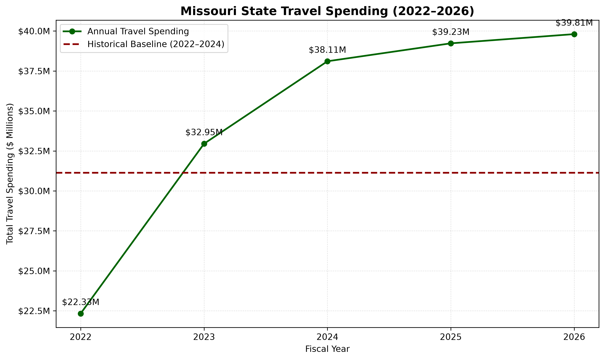

# cintel-05-drift-detection

[](pyproject.toml)

[](https://github.com/Angie-Crews/cintel-05-drift-detection/actions/workflows/ci-python-zensical.yml)

[](https://Angie-Crews.github.io/cintel-05-drift-detection/)

[](https://docs.astral.sh/uv/)
[](https://docs.astral.sh/ty/)
[](https://zensical.org/)
[](LICENSE)

> Detect changes in system behavior by comparing current and reference data.

## Project Overview

**Author:** Angie Crews
**Date:** 2026 November

This project focuses on drift detection using Missouri State Expenditures travel data.

The goal is to compare historical and recent travel spending to identify changes in spending patterns that may need further investigation.

For my custom analysis, I used Missouri travel expenditure data from fiscal years 2022 through 2026. I established a historical baseline using 2022–2024 and compared spending in 2025 and 2026 against that baseline.

The analysis examines three measurements:

- Total annual travel spending
- Number of travel transactions
- Average travel payment

A 10% threshold was used to identify potential drift in spending patterns.

The project is configured in [pyproject.toml](pyproject.toml).

## Data

### Original Project Data

The original drift detection example uses two datasets from `data/`:

- **Reference data** - measurements representing earlier system behavior.
- **Current data** - measurements representing a more recent period.

Both datasets include:

- `requests` - number of requests handled.
- `errors` - number of failed requests.
- `total_latency_ms` - total response time in milliseconds.

### Custom Missouri Travel Expenditure Data

My custom analysis uses Missouri State Expenditures data for fiscal years 2022 through 2026.

**Data Source:** [Missouri State Expenditures](https://data.mo.gov/)

The five CSV files are stored in the `data/` folder.

Each dataset contains six original columns:

- `Fiscal Year`
- `Agency Name`
- `Category Description`
- `Detail Description`
- `Vendor Name`
- `Payments Total`

The analysis filters records where Category Description equals TRAVEL and converts payment amounts into numeric values.

The historical baseline uses fiscal years 2022–2024, while fiscal years 2025–2026 are used to evaluate potential drift.

All five years were checked for missing travel payment amounts, and no missing values were found.

## Approach

### Original Project

The original drift detection pipeline uses Polars to:

1. Calculate summary statistics for reference and current data.
2. Calculate differences between reference and current averages.
3. Compare the differences against drift thresholds.
4. Record which measurements indicate drift.

### Custom Missouri Travel Spending Analysis

My custom analysis uses Polars and Python to examine changes in Missouri travel spending from 2022 through 2026.

The analysis follows these steps:

1. **Load and validate data** - Read five annual expenditure files and check their structure.
2. **Prepare travel records** - Filter travel expenditures and convert payment amounts into numeric values.
3. **Calculate annual metrics** - Determine total spending, transaction counts, and average payments for each year.
4. **Establish a historical baseline** - Calculate average annual measurements using 2022–2024.
5. **Compare recent spending** - Measure differences between the historical baseline and 2025–2026.
6. **Detect potential drift** - Apply a 10% threshold to identify changes in spending patterns.
7. **Visualize results** - Create a chart showing annual spending compared with the historical baseline.
8. **Save results** - Export the annual summary, drift detection results, and spending chart.

The custom analysis is available in [missouri_travel_drift_analysis.ipynb](notebooks/missouri_travel_drift_analysis.ipynb).

### Project Components

- [pyproject.toml](pyproject.toml) - project configuration and dependencies.
- [src/cintel/drift_detector.py](src/cintel/drift_detector.py) - original drift detection pipeline.
- [notebooks/missouri_travel_drift_analysis.ipynb](notebooks/missouri_travel_drift_analysis.ipynb) - custom Missouri travel analysis.
- [data/](data/) - original and Missouri expenditure datasets.
- [artifacts/](artifacts/) - generated results and visualizations.
- [tests/](tests/) - automated tests.
- [.github/workflows/](.github/workflows/) - automated checks and documentation deployment.
- [docs/](docs/) - project documentation.

## Run the Project

Follow the [Professional Python Workflow Guide](https://denisecase.github.io/pro-analytics-02/) to set up your machine and project environment.

### Run the Original Drift Detection Pipeline

From a VS Code terminal in the project root:

```powershell
uv sync
uv run python -m cintel.drift_detector
```

This runs the original drift detection example and saves the results in the `artifacts/` folder.

### Run the Custom Missouri Travel Spending Analysis

The custom analysis uses a Jupyter notebook to examine Missouri travel spending from 2022 through 2026.

1. Open the project in VS Code.
2. Run `uv sync` in the terminal to install the project dependencies.
3. Open `notebooks/missouri_travel_drift_analysis.ipynb`.
4. Select the project's `.venv` Python kernel.
5. Click **Run All** to execute the notebook.

The notebook uses Polars for data processing and Matplotlib for visualizations.

It calculates annual travel spending metrics, compares recent years against the historical baseline, and identifies potential drift using a 10% threshold.

The analysis saves the following files in `artifacts/`:

- `missouri_travel_annual_summary.csv`
- `missouri_travel_drift_results.csv`
- `missouri_travel_spending_chart.png`

## Run the Reactive App

From a VS Code terminal in the project root
(hit CTRL + c to quit):

```shell
uv run marimo run  src/cintel/app.py
```

## Results

### Original Drift Detection Pipeline

The original pipeline produces:

- `artifacts/drift_summary.csv` - summary comparisons and drift flags.
- `artifacts/drift_summary_long.csv` - comparison results in a longer format.
- `artifacts/drift_stats.csv` - statistical comparison of error rates.

Successful execution produces:

```text
========================
Pipeline executed successfully!
========================
```

A `project.log` file is created in the project root.

### Custom Missouri Travel Spending Results

The custom analysis examined Missouri State Expenditures travel spending from 2022 through 2026.

| Fiscal Year | Total Travel Spending |
|---|---:|
| 2022 | $22,330,482.40 |
| 2023 | $32,951,229.70 |
| 2024 | $38,108,544.15 |
| 2025 | $39,229,482.41 |
| 2026 | $39,806,024.51 |

The historical baseline (2022–2024) averaged approximately **$31.13 million** in annual travel spending.

### Drift Detection Findings

Using a 10% threshold, the analysis identified potential drift in both 2025 and 2026.

| Measurement | 2025 Change | 2026 Change |
|---|---:|---:|
| Total Spending | +26.02% | +27.87% |
| Transactions | +14.09% | +10.14% |
| Average Payment | +11.47% | +17.18% |

All three measurements exceeded the selected threshold in both years.

These findings suggest that Missouri travel spending patterns changed compared with the historical baseline. However, additional investigation would be needed to determine the reasons for these changes.

### Travel Spending Visualization



The chart compares annual travel spending with the historical baseline.

### Generated Artifacts

The custom notebook saves:

- [missouri_travel_annual_summary.csv](artifacts/missouri_travel_annual_summary.csv) - annual travel spending measurements.
- [missouri_travel_drift_results.csv](artifacts/missouri_travel_drift_results.csv) - drift detection flags.
- [missouri_travel_spending_chart.png](artifacts/missouri_travel_spending_chart.png) - annual spending visualization.

### Conclusion

Missouri travel spending increased between 2022 and 2026. Both 2025 and 2026 exceeded the selected drift threshold when compared with the 2022–2024 baseline.

This analysis demonstrates how drift detection can help identify changes in financial data that may require further review.

The results indicate potential drift rather than proving that the changes are statistically significant or unusual.

## Project Documentation

The [hosted documentation site](https://Angie-Crews.github.io/cintel-05-drift-detection/) is published using Zensical and GitHub Pages.

The documentation site presents the project report, including data, methods, results, visualizations, interpretation, and conclusions.


## CI/CD and GitHub Actions

This project uses continuous integration and continuous deployment (CI/CD) to check project files and publish documentation.

GitHub Actions include:

- [CI: Python and Documentation Checks](https://github.com/Angie-Crews/cintel-05-drift-detection/actions/workflows/ci-python-zensical.yml)
- [CD: Documentation Deployment](https://github.com/Angie-Crews/cintel-05-drift-detection/actions/workflows/deploy-zensical.yml)

These workflows help verify the project and publish the documentation through GitHub Pages.

## Developer Reference

Follow the
[Professional Python Workflow Guide](https://denisecase.github.io/pro-analytics-02/)
for **detailed instructions and troubleshooting**.

### Initialize and Update the Python Environment

With the project open in VS Code, open a VS Code terminal.
Paste each command and hit Enter or Return after to run it.

```shell
uvx pup-clean --delete
uv self update
uv python pin 3.14
uv python install
uv lock --upgrade
uv sync
uv audit
```

### Set Up and Run Git Hooks

Set up and run the git hooks to perform
basic checks automatically before
any changes get pushed to GitHub.

In the VS Code terminal,
paste each command and hit Enter or Return after to run it.

```shell
uvx prek install --force
uvx prek update --freeze --cooldown-days 7

git add -A
uvx prek run --all-files
# repeat if changes were made
uvx prek run --all-files
```

### Run Common Chores

Run linters, formatters, type checks, tests, and
build the documentation.

```shell
uv run ruff check . --fix
uv run ruff format .

uv run ty check
uv run python -m pytest
uv run python -m zensical build
```

### Git add-commit-push to GitHub

After making useful changes, save your work to GitHub.

```shell
git add -A
git commit -m "describe your changes in quotes"
git push -u origin main
```

## Developer Notes

- Use the **UP ARROW** and **DOWN ARROW** in the terminal to scroll through past commands.
- Use `CTRL+f` to find (and replace) text within a file.

## Developer Tools

This project uses professional Python tools to support development,
testing, documentation, and code quality.

- [uv](https://docs.astral.sh/uv/) - Python environments and dependencies.
- [Ruff](https://docs.astral.sh/ruff/) - Python linting and formatting, configured in [.ruff.toml](.ruff.toml).
- [ty](https://docs.astral.sh/ty/) - Python type checking.
- [pytest](https://docs.pytest.org/) - automated Python testing, configured in [.pytest.toml](.pytest.toml).
- [prek](https://prek.j178.dev/) - Git hooks and automated checks, configured in [prek.toml](prek.toml).
- [Zensical](https://zensical.org/) - project documentation, configured in [zensical.toml](zensical.toml).

## Links

- [GitHub Repository](https://github.com/Angie-Crews/cintel-05-drift-detection)
- [Hosted Documentation](https://Angie-Crews.github.io/cintel-05-drift-detection/)
- [Professional Python Workflow Guide](https://denisecase.github.io/pro-analytics-02/)
- [Citation](CITATION.cff)
- [License](LICENSE)
