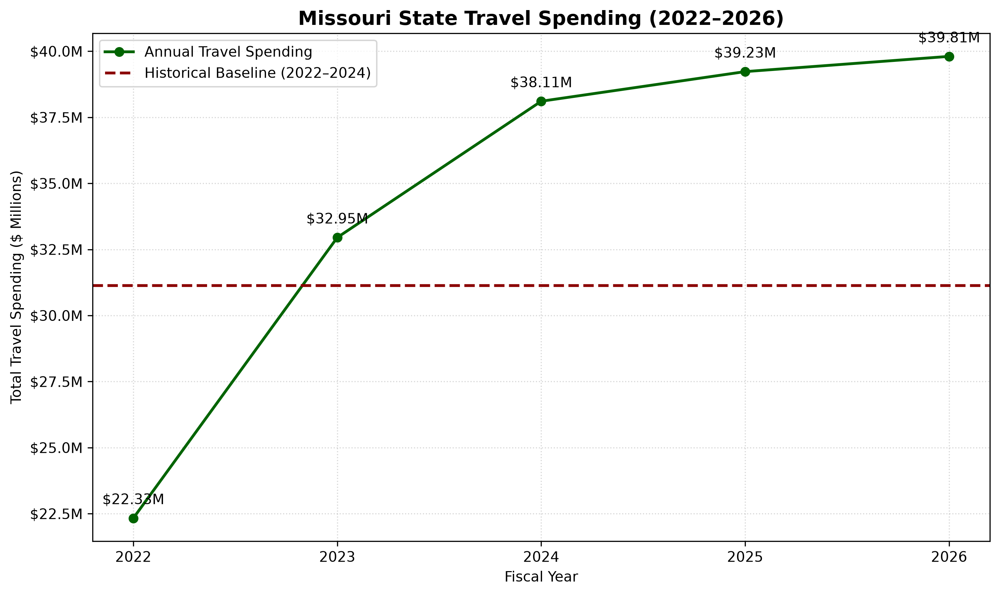

# Drift Detection: System Behavior and Missouri Travel Spending

Continuous Intelligence | Project 05 | Drift Detection Report

**Author:** Angie Crews
**Date:** 2026 November

## Overview

This project examines how drift detection can identify changes between historical and recent data.

The original project compares system measurements, including requests, errors, and latency, to identify changes that may require investigation.

For my custom analysis, I used Missouri State Expenditures travel data from fiscal years 2022 through 2026.

I established a historical baseline using 2022–2024 and compared spending in 2025 and 2026 against that baseline.

The analysis focuses on three measurements:

- Total annual travel spending
- Number of travel transactions
- Average travel payment

A 10% threshold was used to identify potential drift in travel spending patterns.

The goal is to demonstrate how drift detection can be applied to financial data to identify changes that may need further review.

## Data

### Original Project Data

The original drift detection project uses two datasets:

- Reference data representing earlier system behavior.
- Current data representing more recent system behavior.

Each dataset contains measurements of requests, errors, and total latency.

- [View Reference Data](https://github.com/Angie-Crews/cintel-05-drift-detection/blob/main/data/reference_metrics.csv)
- [View Current Data](https://github.com/Angie-Crews/cintel-05-drift-detection/blob/main/data/current_metrics.csv)

### Missouri Travel Expenditure Data

My custom analysis uses Missouri State Expenditures data for fiscal years 2022 through 2026.

**Source:** [Missouri State Expenditures](https://data.mo.gov/Government-Administration/2026-State-Expenditures/gndj-tfr3/about_data)

The five annual CSV files are stored in the `data/` folder.

The analysis uses these fields:

- `Fiscal Year`
- `Agency Name`
- `Category Description`
- `Detail Description`
- `Vendor Name`
- `Payments Total`

Records were filtered to include only the `TRAVEL` category. Payment amounts were converted into numeric values for analysis.

### Historical and Recent Periods

- **Historical baseline:** Fiscal years 2022–2024
- **Recent comparison:** Fiscal years 2025–2026

The data was checked for missing travel payment amounts before calculating annual spending measurements.

No missing travel payment amounts were found.

## Methods

### Original Drift Detection Method

The original pipeline calculates the mean of each metric for both observation periods.

It then calculates:

    difference = current_mean - reference_mean

Drift is flagged when the absolute difference exceeds the configured threshold.

The original thresholds are:

- Requests: 20
- Errors: 2
- Total latency: 1,000 milliseconds

These thresholds are illustrative and should be justified for a production monitoring system.

### Missouri Travel Spending Analysis

My custom analysis uses Python, Polars, and Matplotlib to examine Missouri travel spending from 2022 through 2026.

The analysis follows these steps:

1. Load the five annual expenditure datasets.
2. Filter records to include only the `TRAVEL` category.
3. Convert payment amounts into numeric values.
4. Calculate total annual spending, transaction counts, and average payments.
5. Establish a historical baseline using the average annual measurements from 2022–2024.
6. Compare 2025 and 2026 against the historical baseline.
7. Calculate percentage changes for each measurement.
8. Flag potential drift when the absolute percentage change exceeds 10%.
9. Create a chart showing annual spending and the historical baseline.
10. Save the analysis results in the `artifacts/` folder.

### Drift Detection Threshold

The custom analysis uses a 10% threshold for all three measurements.

Percentage change is calculated as:

    Percentage Change = ((Recent Value - Baseline Value) / Baseline Value) * 100

A measurement is flagged for potential drift when its absolute percentage change is greater than 10%.

This threshold is used as a simple monitoring rule rather than a statistical significance test.

### Analysis Notebook

The complete custom analysis is available in the [Missouri Travel Drift Analysis Notebook](https://github.com/Angie-Crews/cintel-05-drift-detection/blob/main/notebooks/missouri_travel_drift_analysis.ipynb).

## Results

### Original Drift Detection Results

The original pipeline compared reference and current system measurements.

| Metric | Reference Mean | Current Mean | Difference |
|---|---:|---:|---:|
| Requests | 128.3 | 164.5 | +36.2 |
| Errors | 2.3 | 6.3 | +4.0 |
| Total latency (ms) | 3,835 | 5,670 | +1,835 |

With the original thresholds, all three measurements were flagged for drift.

### Missouri Travel Spending Results

The custom analysis examined travel expenditures from 2022 through 2026.

| Fiscal Year | Total Spending | Transactions | Average Payment |
|---|---:|---:|---:|
| 2022 | $22,330,482.40 | 26,629 | $838.58 |
| 2023 | $32,951,229.70 | 36,560 | $901.29 |
| 2024 | $38,108,544.15 | 38,691 | $984.95 |
| 2025 | $39,229,482.41 | 38,746 | $1,012.48 |
| 2026 | $39,806,024.51 | 37,402 | $1,064.28 |

The historical baseline (2022–2024) averaged approximately $31.13 million in annual travel spending.

### Drift Detection Findings

The analysis compared 2025 and 2026 against the historical baseline using a 10% threshold.

| Measurement | 2025 Change | 2026 Change |
|---|---:|---:|
| Total Spending | +26.02% | +27.87% |
| Transactions | +14.09% | +10.14% |
| Average Payment | +11.47% | +17.18% |

All three measurements exceeded the selected threshold in both years.

These results indicate potential changes in Missouri travel spending patterns that may require further investigation.

### Travel Spending Visualization

The chart shows annual Missouri travel spending from 2022 through 2026 compared with the historical baseline.

### Generated Artifacts

- [Annual Spending Summary](https://github.com/Angie-Crews/cintel-05-drift-detection/blob/main/artifacts/missouri_travel_annual_summary.csv)
- [Drift Detection Results](https://github.com/Angie-Crews/cintel-05-drift-detection/blob/main/artifacts/missouri_travel_drift_results.csv)
- [Travel Spending Chart](https://github.com/Angie-Crews/cintel-05-drift-detection/blob/main/artifacts/missouri_travel_spending_chart.png)

## Threshold Experiment

### Objective

Test how increasing the errors drift threshold affects the detection results.

### Modification

Changed `ERRORS_DRIFT_THRESHOLD` from 2.0 to 5.0 in `src/cintel/drift_detector.py`.

### Prediction

Since the difference in average errors was 4.0, I predicted that increasing the threshold to 5.0 would prevent errors from being flagged for drift.

### Results

| Measurement | Original | Modified |
|---|---|---|
| Errors threshold | 2.0 | 5.0 |
| Average errors difference | 4.0 | 4.0 |
| Errors drift flag | True | False |
| Requests drift flag | True | True |
| Latency drift flag | True | True |

The pipeline ran successfully after the modification. Errors were no longer flagged for drift, while requests and latency remained flagged.

### What I Learned

Increasing the threshold makes drift detection less sensitive. This experiment showed how threshold selection affects which changes are identified for further investigation.

**With the original thresholds, all three metrics were flagged for drift. After increasing the errors threshold to 5.0, only requests and latency were flagged..**

[View Drift Results](https://github.com/denisecase/cintel-05-drift-detection/blob/main/artifacts/drift_summary.csv)

[View Detailed Summary](https://github.com/denisecase/cintel-05-drift-detection/blob/main/artifacts/drift_summary_long.csv)

## Interpretation

### Original Drift Detection Project

The original project showed increases in average requests, errors, and total latency.

These changes suggest that the system was operating differently from its historical reference period.

The threshold experiment also demonstrated how changing a threshold affects which measurements are flagged for drift.

### Missouri Travel Spending Analysis

Missouri travel spending increased from approximately $22.33 million in 2022 to $39.81 million in 2026.

Both 2025 and 2026 exceeded the 10% drift threshold for total spending, transaction counts, and average payments when compared with the 2022–2024 baseline.

These findings suggest changes in travel spending patterns that may need further investigation.

Possible explanations include increased travel activity, higher travel costs, or changes in agency spending needs. Additional information would be needed to determine the actual causes.

## Limitations

The original project and custom analysis use fixed thresholds to identify potential drift.

These methods do not establish statistical significance or account for all possible factors affecting the data.

For the Missouri analysis:

- The historical baseline includes only three fiscal years.
- Travel spending was already increasing during the baseline period.
- The analysis does not adjust for inflation.
- Differences in agency activity or travel requirements were not examined.
- The completeness of the 2026 expenditure data should be confirmed.

The results should be treated as indicators for further investigation rather than proof of unusual or inappropriate spending.

## Conclusion

This project demonstrated how drift detection can identify changes between historical and recent measurements.

The original experiment showed how adjusting thresholds changes detection results.

My custom Missouri Travel Spending Analysis applied these concepts to financial data from 2022 through 2026.

Both 2025 and 2026 exceeded the selected 10% threshold for all three travel spending measurements.

The analysis shows how continuous intelligence techniques can help monitor financial activity and identify changes that may require additional review.

## Documentation Index

- **Home** - this landing page
- [Project Instructions](project-instructions.md)
- [Glossary](glossary.md)
- [API](api.md)
- [Reactive App](./app/index.html)

## Project Links

- [GitHub Repository](https://github.com/Angie-Crews/cintel-05-drift-detection)
- [Original Drift Detection Pipeline](https://github.com/Angie-Crews/cintel-05-drift-detection/blob/main/src/cintel/drift_detector.py)
- [Missouri Travel Spending Notebook](https://github.com/Angie-Crews/cintel-05-drift-detection/blob/main/notebooks/missouri_travel_drift_analysis.ipynb)
- [Results and Artifacts](https://github.com/Angie-Crews/cintel-05-drift-detection/tree/main/artifacts)

## Project Resources

- [Project Instructions](project-instructions.md)
- [Professional Python Guide](https://denisecase.github.io/pro-analytics-02/)
- [Professional Python Project Explainer](https://pup-pack.github.io/professional-python-project-explainer/).
- [Suggested Datasets](https://denisecase.github.io/pro-analytics-02/reference/datasets/cintel/)
